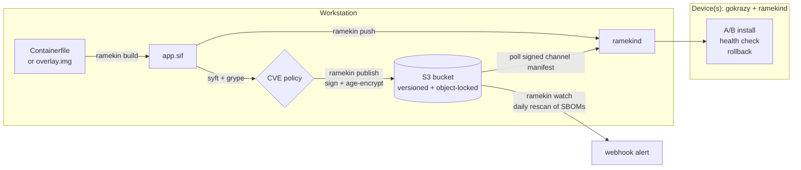

# Ramekin
IoT development, deployment, and update platform

Ramekin is a minimal Linux OS for IoT bare metal. It is built on [gokrazy](https://gokrazy.org) and runs a **single** static [Apptainer](https://apptainer.org) SIF container, by default based on `cgr.dev/chainguard/wolfi-base`. It is inspired by CoreOS, RancherOS and Talos.

The device runs gokrazy's Go init plus one Ramekin program, `ramekind`. There is no shell, no apptainer binary and no package manager on the device. `ramekind` mounts and runs the SIF itself, and it handles signature checks, decryption, S3 polling, health-gated installs and rollback in-process.



## Quick start: Hello World

In this walkthrough you serve a "Hello World" web page from a gokrazy device, then change the page and push the update. It takes about 20 seconds per build.

**Prerequisites on the workstation:**
- Go
- `apptainer`
- `podman` or `docker`
- [`gok`](https://gokrazy.org/quickstart/) to flash the device
- Optionally, [`syft`](https://github.com/anchore/syft) and [`grype`](https://github.com/anchore/grype) for CVE scans. Without them, pass `--no-scan` to `build` and `push`.

The examples assume an arm64 board, which is the default `platform`. For a PC or VM, use `ramekin init --platform linux/amd64` and `device init --target amd64`.

**1. Install the CLI and create a project.**

```sh
go install github.com/ascension-association/ramekin/cmd/ramekin@latest
ramekin init hello-web && cd hello-web && rm app.sh
ramekin keys generate
```

**2. Write the app.** Create `main.go`, a tiny static file server with a health endpoint:

```go
// hello-web serves a directory over HTTP, plus /healthz for ramekind.
package main

import (
	"flag"
	"log"
	"net/http"
)

func main() {
	addr := flag.String("addr", ":80", "listen address")
	root := flag.String("root", "/srv", "directory to serve")
	flag.Parse()
	http.Handle("/", http.FileServer(http.Dir(*root)))
	http.HandleFunc("/healthz", func(w http.ResponseWriter, r *http.Request) { w.Write([]byte("ok\n")) })
	log.Printf("serving %s on %s", *root, *addr)
	log.Fatal(http.ListenAndServe(*addr, nil))
}
```

Create `index.html`:

```html
<!doctype html>
<title>Ramekin</title>
<h1>Hello World</h1>
```

Replace the generated `Containerfile` with:

```dockerfile
# Compile natively on the workstation and cross-compile for the device: no qemu needed.
FROM --platform=$BUILDPLATFORM cgr.dev/chainguard/go:latest AS build
ARG TARGETOS TARGETARCH
WORKDIR /src
COPY main.go .
RUN CGO_ENABLED=0 GOOS=$TARGETOS GOARCH=$TARGETARCH go build -trimpath -ldflags=-s -o /hello-web main.go

FROM cgr.dev/chainguard/wolfi-base:latest
COPY --from=build /hello-web /usr/bin/hello-web
COPY index.html /srv/index.html
# Port 80 is free: Ramekin moves gokrazy's dashboard to 8181.
CMD ["/usr/bin/hello-web", "-addr", ":80", "-root", "/srv"]
```

**3. Build.** This produces an 8 MiB SIF and scans it. On wolfi-base, expect zero findings.

```sh
ramekin build
```

**4. Create and flash a development device.**

```sh
ramekin device init hello --no-updates --health-http http://127.0.0.1/healthz
gok -i hello overwrite --full /dev/sdX      # use your SD card or disk; this erases it
```

- `--no-updates` makes this a dev device: it accepts `ramekin push` and ignores S3.
- `--health-http` makes the device accept a new release only after `/healthz` answers.
- If `~/gokrazy/hello` already exists, `device init` adds ramekind to it instead of creating it. Run `gok -i hello add github.com/ascension-association/ramekin/cmd/ramekind` first (or the path of a local checkout's `cmd/ramekind`), then `ramekin device update hello` instead of `overwrite`.

**5. Push and open the page.**

```sh
ramekin push hello                          # OK: hello is running dev-…
curl http://hello/                          # <h1>Hello World</h1>
```

**6. Change it and push again.**

```sh
sed -i 's|<h1>Hello World</h1>|<h1>Hello, World!</h1>|' index.html
ramekin build && ramekin push hello --version hello-2
curl http://hello/                          # <h1>Hello, World!</h1>
ramekin status hello                        # current: hello-2, previous: the first push
ramekin logs hello -f
```

If the new image fails its health check, the device keeps serving the old page, and `push` reports `ROLLED BACK`.

### Ports and the gokrazy dashboard

The container shares the device's network, so it can't use ports the device already uses. Ramekin moves gokrazy's dashboard off port 80, so ports 80 and 443 are free for your app:

| Port | Used by |
|---|---|
| 8181 | gokrazy dashboard (`http://<device>:8181/`) and its update API |
| 8095 | ramekind API (`push`, `logs`, `status`), set by `listen` in device.json |

`ramekin device init` sets `"Update": {"HTTPPort": "8181"}` in the instance config. gok uses that setting both to configure the device and to connect to it.

Update the device's OS or agent with `ramekin device update <device>`. It runs `gok update` for you.

**Moving an existing instance:** if `device init` adds ramekind to an existing instance whose dashboard is still on port 80, it switches the config to 8181. The device keeps listening on 80 until its next update, so a plain `gok update` would try 8181 and fail. `ramekin device update` detects this and bridges the one transitional update: gok connects to `localhost:8181`, which is forwarded to the device's port 80. Once the device reboots onto 8181, every later update connects there directly.

An instance that already uses a non-default port keeps it.

**Finding a device after its address changes.** DHCP can give a device a new IP when it reboots. After the first successful connection, `ramekin` remembers the device's MAC address in `.ramekin/devices/<device>.json`. If the device stops answering at its recorded address, `push`, `logs`, `status`, `restart` and `device update`:
1. Probe the local `/24` so the workstation learns which IP now has that MAC.
2. Check that the device answers there.
3. Save the new address and carry on.

`ramekin device find <device>` does the same on demand. `device update` points gok at the new IP for that run only, so update `/etc/hosts` or DNS to make the name permanent.

This needs a board whose MAC address survives reboots. Some boards generate a random MAC at each boot (Linux makes one up when no address is programmed into the NIC or the device tree). On those, give the NIC a fixed `local-mac-address` in the device tree. A fixed DHCP reservation then keeps the IP stable too.

### Development modes

Set `source.mode` in `ramekin.yaml`.

**Containerfile mode (infrastructure as code)** is what the quick start uses. Ramekin builds with podman or docker for `platform` and converts the image to a SIF.

**Overlay mode (persistent overlay):**
1. Run `ramekin overlay init` to pull the base image and create `overlay.img`.
2. `ramekin shell` opens a shell in which `apk add`, file edits and everything else persist in `overlay.img`.
3. Set `source.runscript` to your app's command.
4. `ramekin build` flattens base plus overlay into one SIF, including deletions.

A device trusts exactly one signing key: the project's `keys/ramekin-sign.pub`, which `device init` bakes in. To push a different project to the same device, copy over its `keys/` and `.ramekin/` directories, or run `device init` again.

## Publish to the fleet

Create a bucket in [Sliplane Object Storage](https://sliplane.io/object-storage) with **versioning and object locking enabled**. Both must be chosen when the bucket is created. Put the bucket's endpoint URL (from the dashboard) in `store.endpoint` and the bucket name in `store.bucket`, then:

```sh
export RAMEKIN_S3_ACCESS_KEY=... RAMEKIN_S3_SECRET_KEY=...
ramekin publish --version 1.0.0           # gate on CVEs, sign, encrypt, upload, point "stable"
ramekin releases
ramekin promote 0.9.0 --channel stable    # roll the whole fleet back
```

Any S3-compatible store works; set `endpoint` accordingly.

`publish` refuses to ship if findings reach `scan.fail_on` (default `high`). Accepted risks go in `scan.ignore`; `--allow-vulns` overrides the gate once.

### Provision fleet devices

```sh
export RAMEKIN_DEVICE_S3_ACCESS_KEY=... RAMEKIN_DEVICE_S3_SECRET_KEY=...   # read-only key recommended
ramekin device init sensor-01 --health-http http://127.0.0.1/healthz
gok --parent_dir ~/gokrazy -i sensor-01 overwrite --full /dev/sdX
ramekin fleet status
```

Each device polls `channels/<channel>.json` every 5 minutes, with jitter. When it finds a newer serial, it downloads, decrypts, verifies and installs the release.

## How updates and rollback work

The device keeps two images in `/perm/ramekin/images`: **current** and **previous**. A new image is installed like this:

1. It is downloaded to `/perm`, age-decrypted, checked against the manifest's SHA-256, and its SIF signature is verified against the project public key baked into the device.
2. It is recorded as **on trial**. The old container stops and the new one starts.
3. It must stay up for `health.grace` (default 15s) and, if configured, pass `health.http` or `health.tcp` within `health.timeout`.
4. If it passes, it becomes current and the old image becomes previous. If it fails, the old container is restarted and the image is marked bad on that device, so it is never retried automatically.

It also survives power loss and boot failures:

- **Power loss mid-trial:** the trial is retried on the next boot, up to 3 boots, then abandoned.
- **Current release fails at boot:** if it no longer passes its health check, the device falls back to the previous release.
- **Crashes after commit:** the container is restarted with exponential backoff (up to 5 minutes).

Fleet rollback is `ramekin promote <older-version>`. It re-points the channel with a new, higher serial.

gokrazy's own A/B root partitions cover OS and agent updates (`ramekin device update <device>`, which wraps `gok update`).

## CVE alerts

- `ramekin build`, `push` and `scan` generate an SBOM (syft) and match it with grype.
- `publish` uses the scan as a release gate and stores the SBOM next to the release.
- `ramekin watch` rescans the SBOMs of everything currently on a channel against today's vulnerability data, so CVEs disclosed after release still raise alerts. `ramekin init` adds a daily GitHub Actions workflow for it. `ramekin watch --interval 24h` also works as a long-running job.
- Findings at or above `alerts.min_severity` are POSTed to `alerts.webhook`. The JSON body carries `text` (Slack, Mattermost), `content` (Discord) and structured `findings`.

## Security model

| Concern | Mechanism |
|---|---|
| Only your images run | SIF signed with an ECDSA P-256 key (DSSE, interoperable with `apptainer sign/verify --key`). The device verifies it in-process before every install. |
| Bucket tampering / replay | The channel manifest is signed. Devices ignore serials ≤ the highest they have acted on. |
| Confidentiality in S3 | SIFs are encrypted with [age](https://age-encryption.org) to the fleet key and/or per-device keys (`device init --own-key`). |
| Immutable history | Releases are uploaded with S3 object-lock retention (`retention_days`, `GOVERNANCE`/`COMPLIANCE`). Channel pointers are versioned. |
| Push API | Bearer token per device, generated by `device init`. |

Key files: `keys/ramekin-sign.key` and `keys/*.agekey` are secret (gitignored). `keys/ramekin-sign.pub` and `keys/recipients.txt` are safe to commit. In CI, pass the signing key PEM in `RAMEKIN_SIGNING_KEY`.

`~/gokrazy/<device>/config.json` contains the device's secrets: API token, age identity and S3 credentials. Keep it private. gokrazy places them in the device root filesystem, so anyone holding the SD card has them. Use read-only, prefix-scoped S3 credentials for devices.

## Device configuration

`ramekin device init` writes `/etc/ramekin/device.json` into the device's gokrazy instance (`~/gokrazy/<device>/config.json`). Change it with `ramekin device set`. With no flags, it shows the current settings, with secrets hidden:

```sh
ramekin device set hello
ramekin device set hello --health-http http://127.0.0.1/healthz --health-grace 10s
ramekin device set hello --env LOG_LEVEL=debug --bind /dev/ttyUSB0:/dev/ttyUSB0 --apply
```

| Flag | Effect |
|---|---|
| `--health-http URL`, `--health-tcp host:port` | Probe a new release must pass before it is accepted (`""` removes it) |
| `--health-grace D`, `--health-timeout D` | Minimum uptime before probing (default 15s); time allowed for probes to pass (default 2m) |
| `--env KEY=VALUE`, `--unset-env KEY` | Container environment (repeatable) |
| `--bind src:dst[:ro]`, `--unbind dst` | Bind mounts (repeatable; default `data:/data` and `/dev:/dev`) |
| `--command "…"` | Overrides the image's runscript; split on spaces (`""` restores it) |
| `--hostname`, `--channel`, `--interval D` | Container hostname; release channel and poll interval |
| `--apply` | Deploy now via `ramekin device update` (reboots the device) |

Without `--apply`, a change takes effect on the next `ramekin device update`. `device set` checks the result with the agent's own validation before saving, so the device never receives a config it would refuse. It also keeps the previous file as `config.json.bak`.

- **Relative bind sources** live under `/perm/ramekin/` and persist across updates.
- **Settings `device set` doesn't cover** (the API token, keys and S3 credentials) are created by `device init`.

## Limitations and notes

- **Isolation is for packaging, not security.** The container runs as root with mount, PID, IPC and UTS namespaces, but shares the host network and, by default, host `/dev`, which is what GPIO, serial and USB workloads need.
- **Kernel requirements.** The kernel needs loop, squashfs and overlayfs. `ramekind` loads them as modules if they aren't built in, and reports what is missing at startup and in its logs.
- **Encryption is at rest in S3 and in transit, not on the device.** The decrypted SIF on `/perm` is plaintext. Apptainer's native LUKS-encrypted SIFs are not supported by the native runtime.
- **Workloads should handle SIGTERM.** The container's entrypoint is PID 1, and PID 1 ignores SIGTERM unless it installs a handler. Without one, stops wait `stop_timeout` (10s) before SIGKILL.
- **Cross-architecture builds** (amd64 workstation, arm64 devices) need qemu binfmt for `RUN` steps or `ramekin shell`.
- **A dev push stays in place until the next publish.** Pushed images do not advance the channel serial, so a device that also follows a channel switches back when a newer release is published.

## Repository layout

```
cmd/ramekin     developer CLI
cmd/ramekind    device agent (gokrazy package)
internal/agent      supervisor (A/B install, rollback), updater, HTTP API
internal/container  native SIF runtime (loop + squashfs + overlayfs + namespaces)
internal/sifimg     SIF signing/verification (sylabs/sif)
internal/manifest   signed channel manifests
internal/store      S3 (minio-go)
internal/build      Containerfile and overlay builds
internal/scan       syft/grype integration and alerts
```

Run the tests with `go test ./...`. The real container runtime test needs root: `sudo go test ./internal/container`.
