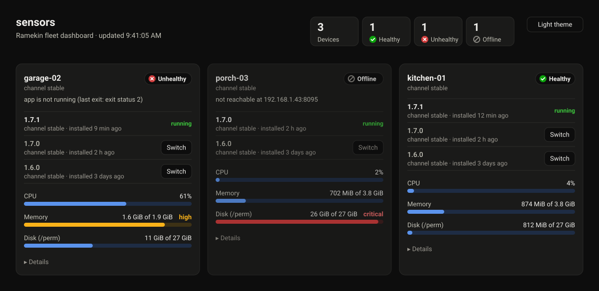
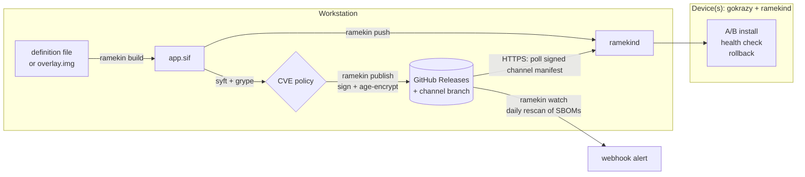

# Ramekin
IoT development, deployment, and update platform

> **ramekin** (*noun*, /ˈræm.ɪ.kɪn/): a small dish for baking and serving a single portion.
>
> That's the idea behind the name: each device is a small container that holds one app and serves it, and nothing else.

Ramekin turns a small board (a Raspberry Pi, a mini PC, or similar) into an appliance that runs one app in a container. The app can be written in any language, and it can be one you already have or one you write from scratch. You build the app on your computer, push it to the device to try it, then publish it to a whole fleet. Every device updates itself safely.

- **Safe updates.** A new version must prove it's healthy before it replaces the old one. If it doesn't, the device rolls back on its own.
- **Secure by default.** Every image is signed and scanned for known vulnerabilities, and fleet releases are encrypted.
- **Tiny devices.** Built on [gokrazy](https://gokrazy.org): no shell or package manager on the device, just your app and one small agent.
- **Simple tooling.** Describe your app in an [Apptainer](https://apptainer.org) definition file (a Dockerfile converts in minutes), or build it interactively in a shell. Apptainer is the only container tool you need.

## Fleet dashboard

`ramekin --dashboard` opens a web page showing every device in the project's `.ramekin/devices`. It refreshes every 5 seconds.

```sh
ramekin --dashboard                         # http://127.0.0.1:8099/, opened in your browser
```



*Example with sample data: a three-device fleet. Devices with problems are listed first.*

For each device it shows:

- **Health:** *Healthy*, *Warning* (update checks failing, or the app has restarted), *Updating* (a release is being health-checked), *Unhealthy* (the app isn't running), *Offline*, or *No release*.
- **Releases:** what's running and the earlier releases the device keeps, each with where it came from (a channel or a push) and when it was installed.
- **Resource use:** CPU, memory, and disk on the data partition (`/perm`). Each meter turns amber at 80% and red at 95%.
- **Details:** uptime, last update check, app restarts and last exit, and rejected releases.

**Switching versions.** Each device keeps its three most recent releases that passed their health check there: the one it's running and two earlier ones. The dashboard lists all three, and **Switch** moves the device to either earlier one, after a confirmation. From the terminal, `ramekin rollback <device>` switches to the previous release, and `ramekin rollback <device> <version>` to any kept one. The device runs the chosen release on trial with its usual health check. If that passes, it becomes current and the release it replaced goes to the top of the list, so you can switch back. If it fails, the device keeps the current release and drops the failed one from the list. A device that follows a channel stays on the version you chose until the channel publishes something newer. To roll back the whole fleet, use `ramekin promote` instead.

The dashboard is read-only apart from switching versions. It has no remote shell or other device controls.

**Security.** There's no login, so the dashboard only listens on a loopback address (`--listen 127.0.0.1:PORT`). To use it from another machine, forward the port with `ssh -L 8099:127.0.0.1:8099 workstation`. Device tokens stay in the `ramekin` process and never reach the browser. The page accepts requests only from itself: it checks the `Host` header and requires a key that changes every time the dashboard starts.

The dashboard reaches devices over the local network, the same way `ramekin status` does. If a device's address changes and its MAC is known, the dashboard searches for it at most every 2 minutes. Devices need a ramekind that reports health and resource use. For an older one, the dashboard shows a warning and you should run `ramekin device update <device>`. Devices you can't reach directly can still report to a webhook with `--status-url`, and the report includes the same health and resource data.

## Quick start: Hello World on a NanoPi R76S

Take a [NanoPi R76S](https://www.friendlyelec.com/index.php?route=product/product&product_id=303) out of the box, flash it, run your first app on it, then change the app. It takes about 10 minutes.

**You need:**
- the R76S, connected to your network, with a screen on its HDMI port;
- a microSD card of 2 GB or more;
- on your Linux computer: [Go](https://go.dev/dl/) and [Apptainer](https://apptainer.org/docs/admin/main/installation.html).

**1. Install the CLI.**

```sh
go install github.com/ascension-association/ramekin/cmd/ramekin@latest
```

**2. Flash the firmware.** Download the [official R76S firmware](https://github.com/ascension-association/firmware.r76s) and write it to the card. Replace `/dev/sdX` with your card; this erases it.

```sh
curl -LO https://github.com/ascension-association/firmware.r76s/releases/latest/download/r76s.img.gz
gunzip -c r76s.img.gz | sudo dd of=/dev/sdX bs=4M conv=fsync status=progress
```

Put the card in the R76S and power it on. After about a minute, its screen shows **Pairing code 123456**.

**3. Create a project.** `app.sh` is your app: it prints "Hello from" and the device's name every 10 seconds. `example.def` packages it into a container.

```sh
ramekin init hello && cd hello
ramekin keys generate
```

**4. Claim the device.** This finds the R76S on your network and asks for the code on its screen. The device then trusts your project's key.

```sh
ramekin device claim hello
```

**5. Build the app and push it to the device.**

```sh
ramekin build --no-scan
ramekin push hello --no-scan
ramekin logs hello -f                         # Hello from hello
```

**6. Change it and push again.**

```sh
sed -i 's/Hello from/Hello World from/' app.sh
ramekin build --no-scan && ramekin push hello --no-scan
ramekin logs hello -f                         # Hello World from hello
```

The device keeps its firmware up to date from the official firmware's channel. A firmware update restarts the device more than once, so expect your app to be briefly unavailable a few times while it installs. A new app version runs only after it starts cleanly; otherwise the device goes back to the previous one.

**7. Optional: run without the SD card.** If your R76S has eMMC storage, install onto it. The device keeps its identity and app, then powers off; remove the card and power it on.

```sh
ramekin device install hello --to emmc        # add --overwrite to erase an OS already on the eMMC
```

**Next:**
- **Scan for vulnerabilities:** install [`syft`](https://github.com/anchore/syft) and [`grype`](https://github.com/anchore/grype), then drop `--no-scan`.
- **Ship to a fleet:** publish releases that every device installs itself (see "Ship to a fleet of devices" below).
- **Watch devices:** `ramekin --dashboard` shows every device.
- **Other boards and techniques:** see the examples under Learn more.

## Learn more

Each section below expands with a click. You don't need any of them to get started.

<details>
<summary><strong>Web Page Example</strong></summary>

Serve a web page from a device with [nginx](https://nginx.org), described in an Apptainer definition file. Then change it and push the update straight to a development device, without publishing a release. Each build takes a few seconds.

It needs Go, Apptainer and [`gok`](https://gokrazy.org/quickstart/), which builds and flashes an OS image for this one device. `syft` and `grype` are optional: without them, pass `--no-scan` to `build` and `push`.

**1. Create a project.**

```sh
ramekin init hello-web && cd hello-web && rm app.sh
ramekin keys generate
```

**2. Write the page.** Create `index.html`:

```html
<!doctype html>
<title>Ramekin</title>
<h1>Hello</h1>
```

Replace the generated `example.def` with this [definition file](https://apptainer.org/docs/user/main/definition_files.html). It starts from Chainguard's nginx image, adds the page, and serves it on port 80:

```singularity
# A static web page served by nginx, from Chainguard's minimal image, which
# is rebuilt often to stay free of known vulnerabilities. The -dev variant
# includes the shell ramekind uses to start it.
Bootstrap: docker
From: cgr.dev/chainguard/nginx:latest-dev

%files
    index.html /usr/share/nginx/html/index.html

%post
    # Serve on port 80, which Ramekin keeps free by moving gokrazy's
    # dashboard to 8181.
    cat > /etc/nginx/conf.d/nginx.default.conf <<'CONF'
server {
    listen 80;
    root /usr/share/nginx/html;
}
CONF
```

**3. Build.** This produces a 23 MiB SIF and scans it. Expect zero findings.

```sh
ramekin build
```

**4. Create and flash a development device.**

```sh
ramekin device init web --no-updates --health-http http://127.0.0.1/
gok -i web overwrite --full /dev/sdX        # use your SD card or disk; this erases it
```

- `--no-updates` makes this a dev device: it accepts `ramekin push` and ignores release channels.
- `--health-http` makes the device accept a new version only after the page returns 200.

**5. Push it and open the page.**

```sh
ramekin push web                            # OK: web is running dev-…
curl http://web/                            # <h1>Hello</h1>
```

**6. Change it and push again.**

```sh
sed -i 's|<h1>Hello</h1>|<h1>Hello World</h1>|' index.html
ramekin build && ramekin push web --version web-2
curl http://web/                            # <h1>Hello World</h1>
ramekin status web                          # current: web-2, previous: the first push
ramekin logs web -f
```

If a new version fails its health check, the device keeps running the old one, and `push` reports `ROLLED BACK`.

This project is in [ramekin-simple-example](https://github.com/ascension-association/ramekin-simple-example), along with [published releases](https://github.com/ascension-association/ramekin-simple-example/releases) of it.

</details>

<details>
<summary><strong>Advanced Example</strong></summary>

A full-stack [TodoMVC](https://todomvc.com) app, with a web page, an API and a SQLite database, as one small Go server. It shows a two-stage definition file that compiles for the device without emulation, a persistent database in `/data`, and a health check that exercises the app. Its releases are published in [ramekin-advanced-example](https://github.com/ascension-association/ramekin-advanced-example/releases).

Start with step 1 of the Web Page Example, using `ramekin init todomvc` instead of `ramekin init hello-web`. Then:

**1. Write the app.** Create `main.go`, the whole server:

```go
// todomvc serves a TodoMVC app: the page, a JSON API, and SQLite storage.
package main

import (
	"database/sql"
	_ "embed"
	"encoding/json"
	"flag"
	"log"
	"net/http"

	_ "modernc.org/sqlite"
)

//go:embed index.html
var page []byte

type todo struct {
	ID        int64  `json:"id"`
	Title     string `json:"title"`
	Completed bool   `json:"completed"`
}

func main() {
	addr := flag.String("addr", ":80", "listen address")
	dbPath := flag.String("db", "/data/todos.db", "SQLite database; keep it in /data so it survives updates")
	flag.Parse()

	db, err := sql.Open("sqlite", *dbPath)
	if err != nil {
		log.Fatal(err)
	}
	db.SetMaxOpenConns(1)
	if _, err := db.Exec(`CREATE TABLE IF NOT EXISTS todos (
		id INTEGER PRIMARY KEY, title TEXT NOT NULL, completed INTEGER NOT NULL DEFAULT 0)`); err != nil {
		log.Fatal(err)
	}

	http.HandleFunc("GET /{$}", func(w http.ResponseWriter, r *http.Request) {
		w.Header().Set("Content-Type", "text/html; charset=utf-8")
		w.Write(page)
	})
	http.HandleFunc("GET /api/todos", func(w http.ResponseWriter, r *http.Request) {
		rows, err := db.Query(`SELECT id, title, completed FROM todos ORDER BY id`)
		if err != nil {
			http.Error(w, err.Error(), http.StatusInternalServerError)
			return
		}
		defer rows.Close()
		todos := []todo{}
		for rows.Next() {
			var t todo
			if err := rows.Scan(&t.ID, &t.Title, &t.Completed); err != nil {
				http.Error(w, err.Error(), http.StatusInternalServerError)
				return
			}
			todos = append(todos, t)
		}
		json.NewEncoder(w).Encode(todos)
	})
	http.HandleFunc("POST /api/todos", func(w http.ResponseWriter, r *http.Request) {
		var t todo
		if err := json.NewDecoder(r.Body).Decode(&t); err != nil || t.Title == "" {
			http.Error(w, "a title is required", http.StatusBadRequest)
			return
		}
		res, err := db.Exec(`INSERT INTO todos (title) VALUES (?)`, t.Title)
		if err != nil {
			http.Error(w, err.Error(), http.StatusInternalServerError)
			return
		}
		t.ID, _ = res.LastInsertId()
		json.NewEncoder(w).Encode(t)
	})
	http.HandleFunc("PATCH /api/todos/{id}", func(w http.ResponseWriter, r *http.Request) {
		var t todo
		if err := json.NewDecoder(r.Body).Decode(&t); err != nil {
			http.Error(w, err.Error(), http.StatusBadRequest)
			return
		}
		exec(w, `UPDATE todos SET completed = ? WHERE id = ?`, db, t.Completed, r.PathValue("id"))
	})
	http.HandleFunc("DELETE /api/todos/{id}", func(w http.ResponseWriter, r *http.Request) {
		exec(w, `DELETE FROM todos WHERE id = ?`, db, r.PathValue("id"))
	})
	http.HandleFunc("DELETE /api/todos", func(w http.ResponseWriter, r *http.Request) {
		exec(w, `DELETE FROM todos WHERE completed`, db) // "Clear completed"
	})

	log.Printf("todomvc on %s, data in %s", *addr, *dbPath)
	log.Fatal(http.ListenAndServe(*addr, nil))
}

func exec(w http.ResponseWriter, query string, db *sql.DB, args ...any) {
	if _, err := db.Exec(query, args...); err != nil {
		http.Error(w, err.Error(), http.StatusInternalServerError)
		return
	}
	w.WriteHeader(http.StatusNoContent)
}
```

Create `index.html`, the page the server embeds:

```html
<!doctype html>
<meta charset="utf-8">
<meta name="viewport" content="width=device-width, initial-scale=1">
<title>todos</title>
<style>
  body { font: 16px system-ui, sans-serif; background: #f5f5f5; max-width: 32rem; margin: 2rem auto; padding: 0 1rem; }
  h1 { text-align: center; font-weight: 200; font-size: 4rem; color: #b83f45; margin: 0 0 1rem; }
  .app { background: #fff; box-shadow: 0 2px 6px rgb(0 0 0 / .15); }
  #new { width: 100%; box-sizing: border-box; padding: 1rem; font-size: 1.25rem; border: 0; border-bottom: 1px solid #eee; }
  ul { list-style: none; margin: 0; padding: 0; }
  li { display: flex; align-items: center; gap: .75rem; padding: .75rem 1rem; border-bottom: 1px solid #eee; }
  li span { flex: 1; }
  li.done span { text-decoration: line-through; color: #999; }
  button { border: 0; background: none; cursor: pointer; color: #777; }
  li button { color: #b83f45; font-size: 1.25rem; }
  footer { display: flex; justify-content: space-between; padding: .75rem 1rem; color: #777; font-size: .875rem; }
</style>
<h1>todos</h1>
<div class="app">
  <input id="new" placeholder="What needs to be done?" autofocus>
  <ul id="list"></ul>
  <footer><span id="left"></span><button id="clear">Clear completed</button></footer>
</div>
<script>
const $ = id => document.getElementById(id);
const api = (path, method = "GET", body) =>
  fetch("/api/todos" + path, { method, body: body && JSON.stringify(body) })
    .then(r => (r.status === 200 ? r.json() : null));

async function render() {
  const todos = await api("");
  $("list").replaceChildren(...todos.map(t => {
    const li = document.createElement("li");
    li.className = t.completed ? "done" : "";
    li.innerHTML = '<input type="checkbox"><span></span><button title="Delete">×</button>';
    li.querySelector("span").textContent = t.title;
    const box = li.querySelector("input");
    box.checked = t.completed;
    box.onchange = () => api("/" + t.id, "PATCH", { completed: box.checked }).then(render);
    li.querySelector("button").onclick = () => api("/" + t.id, "DELETE").then(render);
    return li;
  }));
  const left = todos.filter(t => !t.completed).length;
  $("left").textContent = left + (left === 1 ? " item left" : " items left");
}

$("new").onkeydown = e => {
  const title = e.target.value.trim();
  if (e.key !== "Enter" || !title) return;
  e.target.value = "";
  api("", "POST", { title }).then(render);
};
$("clear").onclick = () => api("", "DELETE").then(render);
render();
</script>
```

Fetch the SQLite driver, which is pure Go, so cross-compiling needs no C toolchain:

```sh
go mod init todomvc && go mod tidy
```

Replace the generated `example.def` with this two-stage [definition file](https://apptainer.org/docs/user/main/definition_files.html). The first stage compiles the server, and the second is what runs on the device:

```singularity
# Build stage: runs on the workstation's architecture and cross-compiles for
# the device ({{ TARGETOS }}/{{ TARGETARCH }}), so no emulation is needed.
Bootstrap: docker
From: cgr.dev/chainguard/go:latest
Stage: build

%files
    go.mod /src/
    go.sum /src/
    main.go /src/
    index.html /src/

%post
    cd /src
    # /cache persists between builds, so rebuilds take seconds.
    export GOMODCACHE=/cache/go/mod GOCACHE=/cache/go/build
    CGO_ENABLED=0 GOOS={{ TARGETOS }} GOARCH={{ TARGETARCH }} go build -trimpath -ldflags=-s -o /todomvc .

# Final stage: what runs on the device, built for its platform.
Bootstrap: docker
From: cgr.dev/chainguard/wolfi-base:latest
Stage: final

%files from build
    /todomvc /usr/bin/todomvc

%runscript
    # The database lives in /data, which persists across updates and rollbacks.
    exec /usr/bin/todomvc -addr :80 -db /data/todos.db "$@"
```

**2. Build.** The first build takes about 30 seconds, including the vulnerability scan; rebuilds take about 10. It produces a 10 MiB SIF. On wolfi-base, expect zero findings.

```sh
ramekin build
```

**3. Create and flash a development device.**

```sh
ramekin device init todo --no-updates --health-http http://127.0.0.1/api/todos
gok -i todo overwrite --full /dev/sdX      # use your SD card or disk; this erases it
```

- `--no-updates` makes this a dev device: it accepts `ramekin push` and ignores release channels.
- `--health-http` makes the device accept a new release only after the API answers, which also proves the database opened.

**4. Push it and add some todos.**

```sh
ramekin push todo                          # OK: todo is running dev-…
```

Open `http://todo/` in a browser and add a few todos. Or use the API:

```sh
curl -X POST -d '{"title":"Buy milk"}' http://todo/api/todos
curl http://todo/api/todos                 # [{"id":1,"title":"Buy milk","completed":false}]
```

**5. Change the title and push again.**

```sh
sed -i 's|>todos<|>Ramekin todos<|g' index.html
ramekin build && ramekin push todo --version todo-2
curl http://todo/api/todos                 # your todos survived the update
ramekin status todo                        # current: todo-2, previous: the first push
ramekin logs todo -f
```

Reload the page to see the new title. The database lives in `/data`, which persists across updates and rollbacks. If a new version fails its health check, the device keeps running the old one, and `push` reports `ROLLED BACK`.

</details>

<details>
<summary><strong>How Ramekin works</strong></summary>

Your workstation builds the app into a single file (an [Apptainer](https://apptainer.org) SIF image). It scans the image for vulnerabilities, then either pushes it straight to a test device or publishes it as a GitHub release that your fleet watches.



The device runs gokrazy's Go init plus one Ramekin program, `ramekind`. There is no shell, no apptainer binary and no package manager on the device. `ramekind` mounts and runs the image itself, and it handles signature checks, decryption, channel polling, health-gated installs and rollback in-process. Images default to the minimal `cgr.dev/chainguard/wolfi-base`. Ramekin is inspired by CoreOS, RancherOS and Talos.

</details>

<details>
<summary><strong>Ship to a fleet of devices</strong></summary>

Releases are published to [GitHub Releases](https://docs.github.com/en/repositories/releasing-projects-on-github/about-releases): free, served from GitHub's CDN, and with no account to create beyond GitHub.

1. **Pick a repository** for releases and put it in `ramekin.yaml` as `releases.github: owner/repo`. Devices download from it anonymously, so make it public. Images are encrypted, but release names, versions and sizes are visible. A dedicated repository (for example `you/your-app-releases`) keeps the release list tidy.
2. **Turn on [immutable releases](https://docs.github.com/en/code-security/concepts/supply-chain-security/immutable-releases)** in that repository (**Settings > General > Releases**). A published release's files and tag can then never be changed or deleted.
3. **Give `ramekin` a token** that can write the repository's contents and releases: `gh auth login`, or a fine-grained token with **Contents: read and write** in `GITHUB_TOKEN`.

```sh
ramekin publish --version 1.0.0           # gate on CVEs, sign, encrypt, create the release, point "stable" at it
ramekin releases
ramekin promote 0.9.0 --channel stable    # roll the whole fleet back
```

What gets published:

| Where | What |
|---|---|
| Release `<app>-<version>` | `<app>.sif.age` (the signed, encrypted image), `sbom.json`, and `manifest.json` (signed) |
| Branch `ramekin-channels`, file `<app>/<channel>.json` | The signed channel pointer devices poll, at `https://raw.githubusercontent.com/<owner>/<repo>/ramekin-channels/<app>/<channel>.json` |

The channel pointer has to change with every publish and promote, so it can't live in an immutable release. `publish` creates the `ramekin-channels` branch on first use, with no history from your other branches. In a repository used only for releases, you can keep the pointers on the default branch instead: set `releases.branch: main` in `ramekin.yaml` (the [advanced example](https://github.com/ascension-association/ramekin-advanced-example) does this).

`publish` refuses to ship if findings reach `scan.fail_on` (default `high`). Accepted risks go in `scan.ignore`; `--allow-vulns` overrides the gate once. It also refuses to reuse a version that has already been published.

**Provision fleet devices:**

```sh
ramekin device init sensor-01 --health-http http://127.0.0.1/
gok --parent_dir ~/gokrazy -i sensor-01 overwrite --full /dev/sdX
```

Each device polls its channel every 5 minutes, with jitter. When it finds a newer serial, it downloads, decrypts, verifies and installs the release. GitHub's CDN caches the channel file for up to 5 minutes, so a publish reaches every device within about 10 minutes.

**Devices need no credentials for updates.** They only download over HTTPS, and everything they download is checked: the channel pointer and manifest are signed by your project key, and the image must match the manifest's SHA-256 and carry a valid signature. So any static host or CDN could serve the same files; set `update.url` in device.json to point a device elsewhere.

**Fleet status:** run `ramekin device set <device> --status-url https://…` to have a device POST a JSON report after every check (its version, previous version, last error and so on) to a webhook or small service of your choice. `ramekin status <device>` shows the same report for a device you can reach directly, and `ramekin --dashboard` shows every device at once (see "Fleet dashboard" above).

</details>

<details>
<summary><strong>How updates and automatic rollback work</strong></summary>

The device keeps the images of its three most recent successful releases in `/perm/ramekin/images`: **current**, **previous** and one before that. A new image is installed like this:

1. It is downloaded to `/perm`, age-decrypted, checked against the manifest's SHA-256, and its SIF signature is verified against the project public key baked into the device.
2. It is recorded as **on trial**. The old container stops and the new one starts.
3. It must stay up for `health.grace` (default 15s) and, if configured, pass `health.http`, `health.tcp` and `health.exec` within `health.timeout`.
4. If it passes, it becomes current and the old image becomes previous. If it fails, the old container is restarted and the image is marked bad on that device, so it is never retried automatically.

It also survives power loss and boot failures:

- **Power loss mid-trial:** the trial is retried on the next boot, up to 3 boots, then abandoned.
- **Current release fails at boot:** if it no longer passes its health check, the device falls back to the previous release.
- **Crashes after commit:** the container is restarted with exponential backoff (up to 5 minutes).

Fleet rollback is `ramekin promote <older-version>`. It re-points the channel with a new, higher serial. To roll back a single device, use `ramekin rollback <device> [version]` or the fleet dashboard. The device keeps its three most recent successful releases (the current one and two earlier ones), and health-checks the one you pick before switching to it.

gokrazy's own A/B root partitions cover OS and agent updates. For one device on your network, `ramekin device update <device>` wraps `gok update`. For a fleet, publish firmware over the air (see the next section).

</details>

<details>
<summary><strong>Official firmware for your board</strong></summary>

The easiest way to run a fleet is **official firmware**: a ready-made image for a board, with gokrazy, the kernel and ramekind, and no project of its own. Anyone can flash it. Devices learn your project when you claim them, and keep following the board's firmware channel for OS updates.

| Board | Repository |
|---|---|
| FriendlyElec NanoPi R76S | [firmware.r76s](https://github.com/ascension-association/firmware.r76s) |

Point your project at it in `ramekin.yaml`:

```yaml
firmware:
  github: ascension-association/firmware.r76s
  board: r76s
```

Flash a device with the image from the firmware's latest release, boot it, and claim it with the pairing code shown on its screen:

```sh
ramekin device claim kitchen-01 192.168.1.40 --health-http http://127.0.0.1/
```

The claim gives the device your project's signing key, app channel and app settings, which it keeps on `/perm`. It then installs your app from your channel.
- **Changing settings:** `ramekin device set kitchen-01 …` changes them over the device's API, signed with the project key.
- **Handing a device over:** `ramekin device release kitchen-01` factory-resets it, for another project or a fresh claim. It erases the device's identity, settings, apps and app data, keeps its firmware, and restarts unclaimed.

**Storage.** Flashed cards start small and fill themselves: the image's `/perm` partition is 164 MB, and on first boot the device grows it, and its file system, to the end of the card. `ramekin status` lists the device's disks (`disks`), including any eMMC or NVMe.

**Installing to eMMC or NVMe.** `ramekin device install kitchen-01 --to emmc` (or `--to nvme`, or a disk name such as `mmcblk0`) moves a device that boots from an SD card onto its internal storage:

1. **Write the image:** the device downloads its firmware's disk image, checks it against the firmware's signed manifest, and writes it to the disk.
2. **Give the disk its own partition IDs:** every card flashed from the image shares them, and the kernel finds its root partition by them.
3. **Copy the data:** it copies its identity, settings, apps and app data, then powers off. Remove the card and power on: it boots from the internal disk and grows `/perm` to fill it.

The command asks you to confirm, and the request is signed with the project key. It refuses a disk that already has partitions, such as a preinstalled OS, unless you add `--overwrite`. The card itself is left unchanged, as a fallback. On the R76S, the board boots from an SD card when one is inserted, so the card must come out. Booting from NVMe depends on the board's bootloader, so check that your board can before installing there.

**Two kinds of trust:**
- **Firmware:** official firmware is signed with the firmware repository's key (`keys/firmware-sign.pub`). It isn't encrypted, because it contains no secrets.
- **Apps:** they're signed with your project's key. The device takes that key from the claim, and the pairing code shows the claim comes from someone with the device in hand.
- **No gokrazy password:** official images have none, so gokrazy's web interface is reachable only from the device itself. A password in a public image would be public. So `ramekin device update` doesn't apply to these devices: their OS comes from the firmware channel.

**Moving devices built for your project over:** a device on your own fleet image trusts only your project's key for firmware. Point `ramekin.yaml` at the official firmware, then push one image built from your fleet image (`ramekin firmware push <device>`). That image follows the official channel and trusts its key, and the device moves to the official firmware on its own.

**Publishing official firmware** (for maintainers of a board's firmware repository, in its checkout):

```sh
ramekin firmware init --board r76s --github ascension-association/firmware.r76s --from <gokrazy instance for the board>
ramekin firmware publish --version 1.0.0
```

`init` writes `firmware.yaml`, creates the firmware signing key, and sets up the gokrazy instance (`~/gokrazy/firmware.r76s`). Commit `firmware.yaml` and `keys/firmware-sign.pub`. Keep `keys/firmware-sign.key` secret and backed up: without it, no more firmware can be published for those devices.

</details>

<details>
<summary><strong>Fleet image, claiming and firmware updates</strong></summary>

`device init` builds an OS image for one board, with that device's name, API token and keys inside it. For a fleet, build one **fleet image** instead. Each device keeps its own identity on its data partition (`/perm`), so the same image, and the same firmware updates, serve every device of a kind.

```sh
ramekin firmware init --from hello            # or --target rpi|amd64; creates ~/gokrazy/<app>-fleet
gok --parent_dir ~/gokrazy -i hello-web-fleet overwrite --full /dev/sdX
ramekin device claim kitchen-01 192.168.1.40  # asks for the pairing code shown on the device
```

**Claiming.**
- **First boot:** a device from the fleet image starts **unclaimed**. It creates its own signing key and age key on `/perm`, runs no app and accepts no updates. It shows a 6-digit pairing code on its console and in its gokrazy log.
- **`device claim`:** with the right code, the workstation signs an identity record with the project key. The record binds the device's name to its public keys and to the board's hardware serial (from the device tree on the Pi and Rockchip boards, or DMI on PCs). The device stores the record, an API token and its own gokrazy password, then restarts as that device.
- **Encryption:** the device's age key is added to `keys/recipients.txt`, so later releases are encrypted to it.
- **Boards built with `device init`:** claim them with their existing token, and no code is needed. They keep their token and gokrazy password.
- **Official firmware:** see the section above. Claiming works the same way, and the claim also carries the project's settings.

**Identity checks.**
- **On the device:** ramekind checks its identity record at every start against the project key, its own keys and the hardware serial. An edited record, or one copied from another device or onto another board, is refused, and the device is treated as unclaimed.
- **On the workstation:** a claimed device signs every answer with its key. `status`, `push`, `rollback`, firmware pushes and the dashboard accept only answers signed with the key recorded at claim time, and status requests carry a fresh nonce so an old answer can't be replayed. Status reports to `--status-url` are signed too, in the `Ramekin-Signature` header.
- **What it doesn't stop:** someone with the device in hand can still copy its keys from the card, or replace the image. Stopping that needs secure boot and hardware key storage (TPM or secure element), which Ramekin doesn't use yet.

**Firmware updates.** Firmware is the fleet image itself: the kernel, gokrazy and ramekind.

```sh
ramekin firmware push kitchen-01 --version 0.9.0    # try it on one claimed device over the network
ramekin firmware publish --version 1.0.0           # release it; every claimed device installs it
```

`publish` encrypts the boot and root partition images to every recipient, signs a firmware manifest, and creates the GitHub release `<app>-firmware-<version>`. Set `releases.firmware: owner/repo` in `ramekin.yaml` to publish firmware to a repository of its own. Devices check the firmware channel along with the app channel, and they install new firmware with a **test boot**:

1. ramekind writes the new root to the spare root partition and the new boot partition in place, then asks gokrazy to boot the new root **once**.
2. It reads the boot partition back first. If gokrazy didn't mark the test boot correctly, it puts the boot partition back and cancels the install instead of rebooting.
3. On the test boot, the new image must start its app, pass the app's health check and reach its firmware channel. Then ramekind makes the image permanent and restarts once more, so gokrazy treats the new root as the active one.
4. If the check fails, ramekind reboots into the previous image. A test boot that hangs also returns to the previous image, at the next reboot or when the hardware watchdog fires. The failed version is recorded and never installed again from the channel.

**A firmware update restarts the device more than once,** and the app stops each time:
- **Into the new image:** for its test boot.
- **Once it's confirmed:** so gokrazy treats the new image's partition as the active one.
- **If it's rejected:** back into the previous image.

Each restart takes about half a minute, so plan for a minute or two in which the app comes and goes. Publish firmware when that's acceptable for your devices.

During a test boot, a failing app isn't rolled back: the firmware is what's on trial. `ramekin status` shows the firmware version, any pending install and failed versions, and so does the dashboard's Details.

**The kernel has no second copy.** It lives on the single boot partition with the device tree and bootloader files. A fallback runs the old root with the new kernel, and a kernel that doesn't boot needs the card rewritten by hand. Try new kernels with `firmware push` on a test device before you publish them.

**Test boots need a fixed gokrazy.** gokrazy releases up to now put the test-boot flag in the wrong place ([gokrazy#395](https://github.com/gokrazy/gokrazy/issues/395)). On boards that boot through systemd-boot (PCs, many EFI arm64 boards), that leaves the device unbootable. On a Raspberry Pi the test boot quietly does nothing. Until the fix ([gokrazy#396](https://github.com/gokrazy/gokrazy/pull/396)) is released, build images with it by adding a `replace` to the gokrazy module in the instance's build directory, then install it once with a normal `ramekin device update`:

```sh
cd ~/gokrazy/<instance>/builddir/github.com/gokrazy/gokrazy
go mod edit -replace github.com/gokrazy/gokrazy=github.com/ben-auo/gokrazy@fix-testboot-cmdline
```

Ramekin's read-back check (step 2) protects devices that don't have the fix yet. It also keeps the hardware watchdog alive on a test boot, when gokrazy's init can't.

</details>

<details>
<summary><strong>Choosing a health check</strong></summary>

A health check is how a device decides that a new version works. If you don't configure one, the container just has to stay up for 15 seconds. Pick the strongest check your app supports:

- **Serves HTTP** (like the Web Page Example): `--health-http http://127.0.0.1/` checks that a page returns 2xx.
- **No ports at all** (a sensor poller, an MQTT publisher): no probe. The container only has to survive the grace period.
- **Listens on a port** (a database, a broker): `--health-tcp 127.0.0.1:5432` checks that the port accepts connections.
- **Has a readiness tool:** `--health-exec` checks that the app actually works. The command runs with the container's own binaries, files, mounts and Unix sockets, using the container's environment and `PATH`. Exit status 0 means healthy; each attempt may take up to 30s.
- **No port, but writes state:** a script fits, e.g. `--health-exec "sh -c 'find /data/heartbeat -mmin -1 | grep -q .'"`.

The command doesn't join the container's process namespace, so anything that lists processes sees the device's processes, not just the container's. Socket-based readiness tools aren't affected.

If you set more than one check, all of them must pass.

</details>

<details>
<summary><strong>Changing device settings</strong></summary>

`ramekin device init` writes `/etc/ramekin/device.json` into the device's gokrazy instance (`~/gokrazy/<device>/config.json`). Change it with `ramekin device set`. With no flags, it shows the current settings, with secrets hidden:

```sh
ramekin device set hello
ramekin device set hello --health-http http://127.0.0.1/ --health-grace 10s
ramekin device set db --health-exec "pg_isready -h 127.0.0.1" --health-timeout 3m
ramekin device set hello --env LOG_LEVEL=debug --bind /dev/ttyUSB0:/dev/ttyUSB0 --apply
```

| Flag | Effect |
|---|---|
| `--health-http URL`, `--health-tcp host:port` | Probe a new release must pass before it is accepted (`""` removes it) |
| `--health-exec "cmd args"` | Command run inside the container that must exit 0, e.g. `pg_isready`, `redis-cli ping` or `sqlite3 /data/app.db 'select 1'` (`""` removes it) |
| `--health-grace D`, `--health-timeout D` | Minimum uptime before probing (default 15s); time allowed for probes to pass (default 2m) |
| `--env KEY=VALUE`, `--unset-env KEY` | Container environment (repeatable) |
| `--bind src:dst[:ro]`, `--unbind dst` | Bind mounts (repeatable; default `data:/data` and `/dev:/dev`) |
| `--command "…"` | Overrides the image's runscript, with shell-style quoting (`""` restores it) |
| `--hostname`, `--channel`, `--interval D` | Container hostname; release channel and poll interval |
| `--apply` | Deploy now via `ramekin device update` (reboots the device) |

Without `--apply`, a change takes effect on the next `ramekin device update`. `device set` checks the result with the agent's own validation before saving, so the device never receives a config it would refuse. It also keeps the previous file as `config.json.bak`.

- **Relative bind sources** live under `/perm/ramekin/` and persist across updates.
- **Settings `device set` doesn't cover** (the API token and keys) are created by `device init`.

</details>

<details>
<summary><strong>Ports, the gokrazy dashboard, and finding your device</strong></summary>

The container shares the device's network, so it can't use ports the device already uses. Ramekin moves gokrazy's dashboard off port 80, so ports 80 and 443 are free for your app:

| Port | Used by |
|---|---|
| 8181 | gokrazy dashboard (`http://<device>:8181/`) and its update API |
| 8095 | ramekind API (`push`, `logs`, `status`), set by `listen` in device.json |

`ramekin device init` sets `"Update": {"HTTPPort": "8181"}` in the instance config. gok uses that setting both to configure the device and to connect to it.

Update the device's OS or agent with `ramekin device update <device>`. It runs `gok update` for you.

**Finding a device after its address changes.** DHCP can give a device a new IP when it reboots. After the first successful connection, `ramekin` remembers the device's MAC address in `.ramekin/devices/<device>.json`. If the device stops answering at its recorded address, `push`, `logs`, `status`, `restart` and `device update`:
1. Probe the local `/24` so the workstation learns which IP now has that MAC.
2. Check that the device answers there.
3. Save the new address and carry on.

`ramekin device find <device>` does the same on demand. `device update` points gok at the new IP for that run only, so update `/etc/hosts` or DNS to make the name permanent.

This needs a board whose MAC address survives reboots. Some boards generate a random MAC at each boot (Linux makes one up when no address is programmed into the NIC or the device tree). On those, give the NIC a fixed `local-mac-address` in the device tree. A fixed DHCP reservation then keeps the IP stable too.

</details>

<details>
<summary><strong>Already have a gokrazy device?</strong></summary>

If `~/gokrazy/<device>` already exists, `ramekin device init <device>` adds ramekind to it instead of creating a new instance. Your other settings are kept, and a backup is saved as `config.json.bak`.

**Ramekin devices run one gokrazy package, plus one optional one:** `github.com/ascension-association/ramekin/cmd/ramekind`, and optionally `github.com/ascension-association/gk-lockscreen` (`device init --lockscreen` adds it to a new instance). Devices you develop with and push to locally may also run gokrazy's development tools: `github.com/gokrazy/breakglass`, `fbstatus`, `hello` and `serial-busybox`. The fleet image may not. The kernel comes from `KernelPackage`, which must be a repository named `kernel` or `kernel.<name>` (gok's default, `github.com/gokrazy/kernel.rpi`, if unset). `device init` and every `device update` enforce this, and so do `firmware init` and every firmware build. They remove any other package from `Packages`, such as a kernel listed there or, in the fleet image, a development tool, together with its `PackageConfig`. They add ramekind if it's missing, keep gk-lockscreen if it's there, and print what changed. Kernel repositories are removed from `Packages` too: gok takes the kernel only from `KernelPackage`. gokrazy's own system services (DHCP, NTP and so on) are configured separately and aren't affected.

```sh
gok -i hello add github.com/ascension-association/ramekin/cmd/ramekind   # or a local checkout's cmd/ramekind
ramekin device init hello --no-updates --health-http http://127.0.0.1/
ramekin device update hello                                                # instead of `gok overwrite`
```

**Moving an existing instance:** if `device init` adds ramekind to an existing instance whose dashboard is still on port 80, it switches the config to 8181. The device keeps listening on 80 until its next update, so a plain `gok update` would try 8181 and fail. `ramekin device update` detects this and bridges the one transitional update: gok connects to `localhost:8181`, which is forwarded to the device's port 80. Once the device reboots onto 8181, every later update connects there directly.

An instance that already uses a non-default port keeps it.

</details>

<details>
<summary><strong>Building with a definition file or a persistent overlay</strong></summary>

Set `source.mode` in `ramekin.yaml`.

**Definition file mode (infrastructure as code)** is the default, and what the Web Page and Advanced examples use. `ramekin build` runs `apptainer build` on your definition file (`source.def` in `ramekin.yaml`; `ramekin init` creates `example.def`, and you can name it anything) with a few additions for devices:

- **Build stages run natively; the final stage is built for the device.** Apptainer's own `--arch` applies to every stage, which would run compilers under emulation. Instead, Ramekin builds on the workstation's architecture and pins only the final stage's base image to the device's platform. It resolves that image at every build, so `latest` keeps receiving fixes. This is the same pattern as Docker's `FROM --platform=$BUILDPLATFORM`.
- **Build arguments:** `{{ TARGETOS }}` and `{{ TARGETARCH }}` (the device, e.g. `linux`/`arm64`) and `{{ BUILDARCH }}` (the workstation), for cross-compiling in a build stage.
- **A persistent build cache at `/cache`** in every stage's `%post`. It lives in `build/cache`. Point tool caches at it (`GOCACHE`, `PIP_CACHE_DIR`, `npm_config_cache`, ...) to make rebuilds fast.
- **Emulation where needed:** `%post` in the final stage runs as the device's architecture, under qemu binfmt when that differs from the workstation's, so keep heavy work in build stages.

Relative `%files` paths resolve from the definition file's directory, and the definition Ramekin actually builds is saved as `build/.ramekin.def`.

**Overlay mode (persistent overlay):**
1. Run `ramekin overlay init` to pull the base image and create `overlay.img`.
2. `ramekin shell` opens a shell in which `apk add`, file edits and everything else persist in `overlay.img`.
3. Set `source.runscript` to your app's command.
4. `ramekin build` flattens base plus overlay into one SIF, including deletions.

The Persistent Overlay Example uses this mode. The shell runs as the device's architecture (under qemu binfmt on a different workstation), so compile programs on the workstation for the device and copy them in, as that example does, rather than installing a compiler in the overlay. Anything installed there ends up in the image.

A device trusts exactly one signing key: the project's `keys/ramekin-sign.pub`, which `device init` bakes in. To push a different project to the same device, copy over its `keys/` and `.ramekin/` directories, or run `device init` again.

</details>

<details>
<summary><strong>Persistent Overlay Example</strong></summary>

Build a small Go program into a container by hand, publish it as version 1, and watch a device install it. Then change the program, publish version 2, and the device updates itself.

**Prerequisites on the workstation:**
- Go
- `apptainer`
- [`gok`](https://gokrazy.org/quickstart/) to flash the device
- A public GitHub repository for the releases, and [`gh`](https://cli.github.com) logged in (or a token in `GITHUB_TOKEN`)
- [`syft`](https://github.com/anchore/syft) and [`grype`](https://github.com/anchore/grype), which scan every release for known vulnerabilities

The examples assume an arm64 board, which is the default `platform`. For a PC or VM, use `ramekin init --platform linux/amd64`, `GOARCH=amd64` and `device init --target amd64`.

**1. Install the CLI and create a project.** This one uses a [persistent overlay](https://apptainer.org/docs/user/main/persistent_overlays.html): you change the container from a shell, and the changes are kept in `overlay.img`. The overlay is here for demonstration, because it shows each step by hand. For real projects, prefer a definition file, which describes the container as code that you can review, version and rebuild from scratch. See "Building with a definition file or a persistent overlay" above; the Web Page and Advanced examples use one.

```sh
go install github.com/ascension-association/ramekin/cmd/ramekin@latest
ramekin init hello-world --mode overlay && cd hello-world
ramekin keys generate
ramekin overlay init                          # pulls wolfi-base, creates overlay.img
```

In `ramekin.yaml`, set the command the container runs and the repository to publish to:

```yaml
source:
  runscript: /usr/bin/hello
releases:
  github: you/your-repo                       # public; turn on immutable releases in its settings
  branch: main
```

**2. Write the program.** Create `main.go`:

```go
// hello prints a greeting, then waits until the device stops it.
package main

import (
	"fmt"
	"os"
	"os/signal"
	"syscall"
)

func main() {
	fmt.Println("Hello")
	// Keep running: the device restarts an app that exits.
	stop := make(chan os.Signal, 1)
	signal.Notify(stop, syscall.SIGTERM, os.Interrupt)
	<-stop
}
```

Compile it for the device, then copy it into the container from `ramekin shell`. The shell sees your project directory, and whatever you change in it persists:

```sh
go mod init hello-world
CGO_ENABLED=0 GOOS=linux GOARCH=arm64 go build -o hello .
ramekin shell
```
```
Apptainer> cp hello /usr/bin/hello
Apptainer> hello                              # Hello (Ctrl-C to stop)
Apptainer> exit
```

**3. Build.** `ramekin build` combines the base image and your overlay into one 7 MiB image and scans it. Expect zero findings.

```sh
ramekin build
```

**4. Create and flash a device.** It follows your repository's `stable` channel:

```sh
ramekin device init hello
gok -i hello overwrite --full /dev/sdX        # use your SD card or disk; this erases it
```

**5. Publish version 1.** This signs and encrypts the image, creates the GitHub release `hello-world-1`, and points the `stable` channel at it.

```sh
ramekin publish --version 1
ramekin logs hello -f                         # Hello
```

The device checks for updates every 5 minutes, and GitHub's CDN can take another 5 to show the change, so allow up to 10 minutes.

**6. Change it and publish version 2.**

```sh
sed -i 's/"Hello"/"Hello World"/' main.go
CGO_ENABLED=0 GOOS=linux GOARCH=arm64 go build -o hello .
echo 'cp hello /usr/bin/hello' | ramekin shell
ramekin build && ramekin publish --version 2
ramekin logs hello -f                         # Hello World, within about 10 minutes
ramekin status hello                          # current: 2, previous: 1
```

If a new version fails to start, the device rolls back to the previous one on its own.

This project is in [ramekin-hello-world-example](https://github.com/ascension-association/ramekin-hello-world-example), along with its [two releases](https://github.com/ascension-association/ramekin-hello-world-example/releases). To try changes on a device without publishing, see the Web Page Example above, which pushes to a development device.

</details>

<details>
<summary><strong>Converting a Dockerfile or container image</strong></summary>

**An existing image** needs only two lines. Apptainer turns the image's `ENTRYPOINT`, `CMD` and `ENV` into the container's runscript and environment:

```singularity
Bootstrap: docker
From: ghcr.io/you/your-app:1.2.3
```

Images that exist only on your workstation can be read with `Bootstrap: docker-daemon` (from a running Docker), or saved first with `docker save -o app.tar your-app` and read with `Bootstrap: docker-archive` and `From: app.tar` (`oci-archive` works the same way). Make sure the image matches the device's architecture: Ramekin only selects the platform automatically for registry images (`Bootstrap: docker`).

**A Dockerfile** maps onto definition file sections like this:

| Dockerfile | Definition file |
|---|---|
| `FROM image` | `Bootstrap: docker` and `From: image` |
| `FROM image AS build` | a stage with `Stage: build` |
| `COPY --from=build /a /b` | `%files from build` with the line `/a /b` |
| `RUN cmd` | `%post` (one shell script that stops at the first failing command) |
| `COPY src dst` | `%files` with the line `src dst` |
| `ADD url` or an archive | `%post`: `curl -fsSLo ...` / `tar -xf ...` |
| `ENV KEY=value` | `%environment` with `export KEY=value` (also `export` it in `%post` if the build needs it) |
| `ARG NAME=default` | `%arguments` with `NAME=default`, used as `{{ NAME }}` |
| `WORKDIR /dir` | `cd /dir` in `%post` and `%runscript` |
| `CMD` / `ENTRYPOINT` | `%runscript` with `exec your-app "$@"` |
| `LABEL key=value` | `%labels` with `key value` |
| `FROM --platform=$BUILDPLATFORM` | not needed: build stages already run natively; use `{{ TARGETOS }}`/`{{ TARGETARCH }}` |
| `RUN --mount=type=cache,...` | write caches under `/cache` |
| `EXPOSE`, `VOLUME`, `USER`, `HEALTHCHECK` | no `.def` equivalent; see below |

The last row covers settings that live on the device instead:
- **Ports:** the container shares the device's network, so the app's own listen address decides the port; there is nothing to `EXPOSE`.
- **Persistent data:** `/data` persists across updates. Add more with `ramekin device set --bind`.
- **User:** the app runs as root on the device. Drop privileges in the app if it needs to.
- **Health checks:** use `ramekin device set --health-http`, `--health-tcp` or `--health-exec`.

**One requirement:** the final stage needs `/bin/sh`, because ramekind uses it to load the image's environment before running the runscript. Distroless or `scratch`-based images have no shell. Use an image variant with a shell (the Web Page Example uses Chainguard's `nginx:latest-dev` rather than `nginx:latest`), copy the app into a small base such as `cgr.dev/chainguard/wolfi-base` (as the advanced example does), or bypass the runscript with `ramekin device set --command "/usr/bin/your-app --flag"`.

</details>

<details>
<summary><strong>Vulnerability scanning and alerts</strong></summary>

- `ramekin build`, `push` and `scan` generate an SBOM (syft) and match it with grype.
- `publish` uses the scan as a release gate and stores the SBOM next to the release.
- `ramekin watch` rescans the SBOMs of everything currently on a channel against today's vulnerability data, so CVEs disclosed after release still raise alerts. `ramekin init` adds a daily GitHub Actions workflow for it. `ramekin watch --interval 24h` also works as a long-running job.
- Findings at or above `alerts.min_severity` are POSTed to `alerts.webhook`. The JSON body carries `text` (Slack, Mattermost), `content` (Discord) and structured `findings`.

</details>

<details>
<summary><strong>Security model</strong></summary>

| Concern | Mechanism |
|---|---|
| Only your images run | SIF signed with an ECDSA P-256 key (DSSE, interoperable with `apptainer sign/verify --key`). The device verifies it in-process before every install. |
| Tampered or replayed downloads | The channel manifest is signed. Devices ignore serials ≤ the highest they have acted on for that channel, and check each image's SHA-256 and signature. |
| Confidentiality of releases | SIFs are encrypted with [age](https://age-encryption.org) to the fleet key and/or per-device keys (`device init --own-key`), so a public release repository exposes only names and sizes. |
| Immutable history | `publish` never reuses a version. With GitHub's immutable releases turned on, a published release's files and tag can't be changed or deleted; `publish` says when they're off. The channel branch's git history records every publish and promote. |
| Push API | Bearer token per device, generated by `device init` or at claim time. |
| Device identity | A claimed device keeps its keys on `/perm` and a record of its identity signed with the project key, bound to the board's hardware serial. It refuses an edited or copied record. Its answers and status reports are signed with its key, and the workstation checks them. |
| OS updates | Firmware is signed and encrypted like apps. It installs with a test boot, and is kept only if the device comes up healthy. |
| Fleet dashboard | Listens only on loopback, with no login. It checks the `Host` header (against DNS rebinding) and requires a per-run key (against cross-site requests). Device tokens never reach the browser. |
| Minimal devices | Each device runs gokrazy's system services, ramekind and (optionally) gk-lockscreen, and nothing else: no shell, no SSH, no other packages. Only local development devices may also run gokrazy's development tools, such as breakglass. `device init`, `device update`, `firmware init` and firmware builds enforce this. |
| No storage credentials on devices | Devices only download, anonymously, over HTTPS. Only the workstation (or CI) holds a GitHub token. |

Key files: `keys/ramekin-sign.key` and `keys/*.agekey` are secret (gitignored). `keys/ramekin-sign.pub` and `keys/recipients.txt` are safe to commit. In CI, pass the signing key PEM in `RAMEKIN_SIGNING_KEY`.

`~/gokrazy/<device>/config.json` contains the device's secrets: its API token and age identity. Keep it private. gokrazy places them in the device root filesystem, so anyone holding the SD card has them; with the shared fleet key, that means they can decrypt releases, so use `device init --own-key` where that matters.

</details>

<details>
<summary><strong>Limitations and notes</strong></summary>

- **Isolation is for packaging, not security.** The container runs as root with mount, PID, IPC and UTS namespaces, but shares the host network and, by default, host `/dev`, which is what GPIO, serial and USB workloads need.
- **Kernel requirements.** The kernel needs loop, squashfs and overlayfs. `ramekind` loads them as modules if they aren't built in, and reports what is missing at startup and in its logs.
- **Encryption is at rest in the release repository and in transit, not on the device.** The decrypted SIF on `/perm` is plaintext. Apptainer's native LUKS-encrypted SIFs are not supported by the native runtime.
- **Workloads should handle SIGTERM.** The container's entrypoint is PID 1, and PID 1 ignores SIGTERM unless it installs a handler. Without one, stops wait `stop_timeout` (10s) before SIGKILL.
- **Cross-architecture builds** (amd64 workstation, arm64 devices) need qemu binfmt for the final stage's `%post` and for `ramekin shell`. Build stages run natively.
- **The kernel can't be rolled back.** Firmware updates fall back to the previous root partition, but the boot partition (kernel, device tree) has one copy. See "Fleet image, claiming and firmware updates".
- **A dev push stays in place until the next publish.** Pushed images do not advance the channel serial, so a device that also follows a channel switches back when a newer release is published.

</details>

<details>
<summary><strong>Contributing</strong></summary>

Repository layout:

```
cmd/ramekin     developer CLI and fleet dashboard (--dashboard)
cmd/ramekind    device agent (gokrazy package)
internal/agent      supervisor (A/B install, rollback), updater, HTTP API, metrics
internal/container  native SIF runtime (loop + squashfs + overlayfs + namespaces)
internal/sifimg     SIF signing/verification (sylabs/sif)
internal/manifest   signed channel manifests
internal/release    GitHub Releases publishing and HTTPS downloads
internal/build      definition file and overlay builds
internal/scan       syft/grype integration and alerts
```

Run the tests with `go test ./...`. The real container runtime test needs root: `sudo go test ./internal/container`.

</details>
